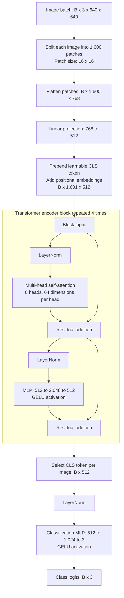

# Vision Transformer (ViT)

A PyTorch image classifier implemented in [`vit_arch.py`](vit_arch.py). Images become patch tokens, pass through Transformer encoder blocks, and are classified using their final CLS tokens.

## Architecture block diagram

## Implementation summary

- **Embedding:** projects non-overlapping patches into 512 dimensions and adds a learnable CLS token and positional embeddings.
- **Encoder:** uses pre-normalization, scaled dot-product attention, and an MLP, with residual connections around attention and the MLP.
- **Head:** normalizes each final CLS token and produces three class logits without softmax.

The example uses `l=4`, `d=512`, `num_heads=8`, and `cls=3`. Input shape is `(B, 3, 640, 640)`; output shape is `(B, 3)`. The included batch of four images produces `(4, 3)`. Image size is fixed to 640 x 640, and `d` must be divisible by `num_heads`.
